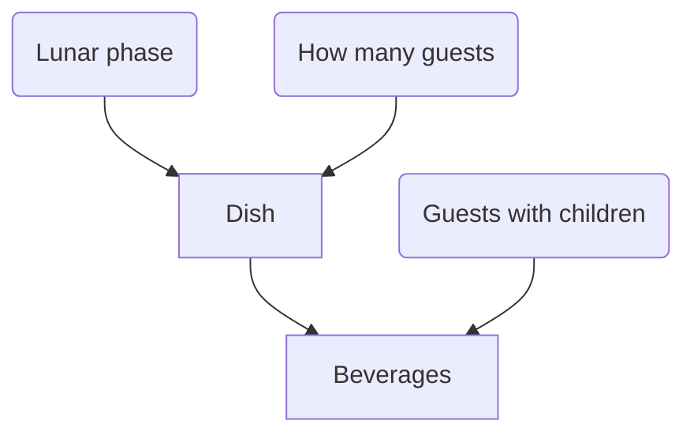

# dmn-check

This is a tool for the validation of [Decision Model Notation (DMN)](https://en.wikipedia.org/wiki/Decision_Model_and_Notation) files. It
performs various static analyses to detect inconsistencies and bugs in your decision models.

You can use `dmn-check` in six ways.

* As a [Maven](https://maven.apache.org/) or [Gradle](https://gradle.org/) plugin that can be integrated into your build
  process and continuous integration to prevent bugs from slipping into your artifacts.
* Integrated into the [Camunda Modeler](https://camunda.com/products/modeler/) via the dmn-check plugin.
* Integrated into your custom tools by using the artifacts [dmn-check-core](https://search.maven.org/artifact/de.redsix/dmn-check-core) or
  [dmn-check-validators](https://search.maven.org/search?q=a:dmn-check-validators).
* As a standalone CLI tool.
* As a [Docker image](https://github.com/red6/dmn-check/pkgs/container/dmn-check) (e.g. in your CI pipeline).
* Integrated in [dmnmgr](https://github.com/davidibl/dmnmgr-client).

Currently, dmn-check checks among others for the following:

* Duplicate rules
* Conflicting rules
* Shadowed rules
* Overlapping rules for hit policy `UNIQUE`
* Types of the expressions
* Correct use of enumerations
* Correctly connected requirement graphs

In section [validations](#validations), you find a complete list with detailed descriptions of what they do.

Most properties and invariants that are validated by `dmn-check` are described informally in
the [DMN specification](https://www.omg.org/spec/DMN). In case you have questions about a validation, it might be worth
skimming the specification.

## Maven Plugin

### Prerequisites

This plugin requires Java 25 or later and Apache Maven 3 or later. Some analyses are tailored towards the Camunda DMN implementation and
might not work for different DMN implementations.

### Usage

`dmn-check` can be used either as a normal Maven plugin inside your project's `pom.xml` or as a standalone program.

#### Configuration in POM

The following example shows the basic configuration of the plugin:

            <plugin>
                <groupId>de.redsix</groupId>
                <artifactId>dmn-check-maven-plugin</artifactId>
                <version>...</version>
                <executions>
                    <execution>
                        <phase>verify</phase>
                        <goals>
                            <goal>check-dmn</goal>
                        </goals>
                    </execution>
                </executions>
            </plugin>

Using this configuration, the plugin will search all folders of the current project for files with the extension `.dmn` and apply all
available validators. It is possible to provide a set of search paths instead, as well as to ignore certain files and specify the validators
that should be executed. The following example shows how you can make use of these options by restricting the search path to the
folders `src/` and `model/`, as well as ignoring file `test.dmn`. The configuration further specifies that only
the [`ShadowedRuleValidator`](#shadowed-rules) should be executed. To specify validators, you have to use the fully qualified name.

                <configuration>
                    <searchPaths>
                        <searchPath>src/</searchPath>
                        <searchPath>model/</searchPath>
                    </searchPaths>
                    <excludes>
                        <exclude>test.dmn</exclude>
                    </excludes>
                    <validatorClasses>
                        <validatorClass>de.redsix.dmncheck.validators.ShadowedRuleValidator</validatorClass>
                    </validatorClasses>
                </configuration>

Additionally, the `failOnWarning` (default is false) parameter can be set to fail a Maven execution if there are
validation errors with Warning severity.

                <configuration>
                    <failOnWarning>true</failOnWarning>
                </configuration>

#### Standalone Usage

To use `dmn-check` without or outside a Maven project, you can invoke it in the following way:

        mvn de.redsix:dmn-check-maven-plugin:check-dmn

## Gradle Plugin

### Prerequisites

This plugin requires Java 25 or later and Gradle 6.5 or later. Some analyses are tailored towards the Camunda DMN implementation and
might not work for different DMN implementations.

## Integrated in dmnmgr

Dmnmgr is _a toolkit incorporating the Camunda DMN implementation and providing tools to develop DMN-based applications in cross-functional teams_.
It ships with a `dmn-check` integration and visualizes the warnings and errors in the graphical representation of the DMN model. You need to install the [dmnmgr-client](https://github.com/davidibl/dmnmgr-client) and [dmnmgr-server](https://github.com/davidibl/dmnmgr-server) to use it.

## As a Docker container

A Docker image containing `dmn-check` is available from the GitHub Container Registry, and you can pull the latest version by executing

    docker pull ghcr.io/red6/dmn-check:latest

If you want to use `docker run` to execute `dmn-check` you have to mount the directory containing the DMN files into
the container and set the search path appropriately, e.g.,

    docker run -v ~/dmn-files:/dmn-files ghcr.io/red6/dmn-check:latest --searchPath=/dmn-files

If you want to use the Docker image in a GitLab pipeline, you have to overwrite the entrypoint and call `dmn-check` directly.
In the following example of a GitLab pipeline, we specify the project classpath as well to make the enum validation possible.

    variables:
      MAVEN_OPTS: "-Dmaven.repo.local=.m2/repository"
    
    default:
      artifacts:
        paths:
          - ./cp.txt
          - .m2/repository
    
    stages:
      - analysis
    
    image:
      name: ghcr.io/red6/dmn-check:latest
      entrypoint: [ "" ]
    
    create-classpath-for-dmn-check:
      image: adoptopenjdk/maven-openjdk11
      stage: analysis
      script: mvn dependency:build-classpath --settings .m2/settings.xml --batch-mode -Dmdep.outputFile=cp.txt
    
    dmn-check:
      stage: analysis
      needs:
        - create-classpath-for-dmn-check
      script: |
        /opt/java/openjdk/bin/java -cp /app/resources:/app/classes:/app/libs/* de.redsix.dmncheck.cli.Main --projectClasspath=$(< cp.txt)

## Validations

The following subsections describe the available validations in detail and how to fix the reported problems. Every
error and warning reported by `dmn-check` links to the corresponding subsection. The DMN decision tables used in this section are derived from an
example on [camunda.org](https://camunda.org/).

### Duplicate Rules

Consider the following DMN decision table with hit policy `UNIQUE`:

|     | Season ᴵᴺᴾᵁᵀ  | How many guests ᴵᴺᴾᵁᵀ | Dish ᴼᵁᵀᴾᵁᵀ |
| --- | ------------- | --------------------- | ----------- |
|  1  | "Fall"        | <= 8                  | "Spareribs" |
|  2  | "Winter"      | <= 8                  | "Roastbeef" |
|  3  | "Spring"      | [5..8]                | "Steak"     |
|  4  | "Winter"      | <= 8                  | "Roastbeef" |

It is pretty clear that rule number two is a duplicate of rule number four. This is not allowed by the `UNIQUE` hit policy
and thus an error.

**Definition**: A rule is a duplicate of another rule if and only if all inputs and outputs of those rules are identical.

`dmn-check` will report duplicate rules for all decision tables, except for those with hit policy `COLLECT`.

**How to fix**: Delete one of the duplicate rules. If both rules are needed, e.g., to count matches, use hit policy `COLLECT`.

### Conflicting Rules

Conflicting rules are somewhat similar to duplicate rules. Consider the following example with hit policy `UNIQUE`:

|     | Season ᴵᴺᴾᵁᵀ  | How many guests ᴵᴺᴾᵁᵀ | Dish ᴼᵁᵀᴾᵁᵀ |
| --- | ------------- | --------------------- | ----------- |
|  1  | "Fall"        | <= 8                  | "Spareribs" |
|  2  | "Winter"      | <= 8                  | "Roastbeef" |
|  3  | "Spring"      | [5..8]                | "Steak"     |
|  4  | "Winter"      | <= 8                  | "Stew"      |

We look again at rules two and four. This time, all their inputs are identical, but they differ in the output. This is arguably worse than a
duplicate rule, since it may produce different results depending on the evaluation order of the decision table, assuming that the runtime
does not detect those inconsistencies.

**Definition**: Rule `r` is in conflict with rule `s` if and only if all inputs of rules `r` and `s` are identical and if they differ
in at least one output.

`dmn-check` will report conflicting rules for all decision tables, except for those with hit policy `COLLECT` and `RULE_ORDER`.

**How to fix**: Decide which output is correct and delete the other rule, or refine the inputs so that the rules no
longer match the same values. If all outputs are intended, use hit policy `COLLECT` or `RULE_ORDER`.

### Shadowed Rules

Some rules prevent others from even being considered. Have a look at the following example with hit policy `FIRST`:

|     | Season ᴵᴺᴾᵁᵀ  | How many guests ᴵᴺᴾᵁᵀ | Dish ᴼᵁᵀᴾᵁᵀ |
| --- | ------------- | --------------------- | ------------|
|  1  | "Fall"        | <= 8                  | "Spareribs" |
|  2  | "Winter"      | <= 8                  | "Roastbeef" |
|  3  | –             | –                     | "Stew"      |
|  4  | "Spring"      | [5..8]                | "Steak"     |

This example contains no duplicate rules and no conflicting rules. However, all inputs of rule three are empty (represented with a dash in
this example). As empty inputs match everything and since we assume hit policy `FIRST`, rule four will never match as rule three matches for
all possible inputs. Therefore, stew is served to groups of 5 to 8 guests in spring. Assuming that each rule serves a purpose, shadowed rules are
always an error as they will never be matched.

**Definition**: Rule `r` shadows rule `s` if and only if the inputs of rule `r` match at least for all values for which the inputs of
rule `s` match.

`dmn-check` will report shadowed rules for all decision tables, except for those with hit policy `COLLECT` and `RULE_ORDER`.

**How to fix**: Move the more specific rule above the more general one, or delete it if it is not needed. Rules with
only empty inputs (catch-all rules) should be the last rule of a decision table with hit policy `FIRST`.

### Overlapping Rules

The hit policy `UNIQUE`, which is the default hit policy, requires that at most one rule matches. Consider the following
example with hit policy `UNIQUE`:

|     | Season ᴵᴺᴾᵁᵀ  | How many guests ᴵᴺᴾᵁᵀ | Dish ᴼᵁᵀᴾᵁᵀ |
| --- | ------------- | --------------------- | ----------- |
|  1  | "Fall"        | <= 8                  | "Spareribs" |
|  2  | "Spring"      | <= 7                  | "Stew"      |
|  3  | "Spring"      | [5..8]                | "Steak"     |

Rules two and three are neither duplicates nor in conflict, but both match if 5 to 7 guests are expected in spring.

**Definition**: Rules `r` and `s` overlap if and only if there is a value for every input such that the inputs of
both rules match.

`dmn-check` will report overlapping rules for decision tables with hit policy `UNIQUE`. Rules whose overlap cannot be
decided, e.g., because their inputs refer to variables, are not reported.

**How to fix**: Adjust the inputs so that the rules match disjoint values, e.g., change `<= 7` to `< 5` in the example above.
If overlapping rules are intended, choose a hit policy that allows multiple matches, e.g., `FIRST`, `PRIORITY` or `COLLECT`.

### Types of Expressions

DMN offers a rich expression language called [Friendly Enough Expression Language](https://docs.camunda.io/docs/components/modeler/feel/what-is-feel/) (FEEL) that can be used to describe the conditions for the input entries. However, as with most
expression languages, not all syntactically possible expressions are valid (have a meaning). `dmn-check` integrates a type checker for the
FEEL expression language that ensures that a decision table contains only well-typed expressions.

An example of an ill-typed expression is `[1..true]` which would describe the range between `1` and `true` which is (at least in FEEL) not a
valid expression. In contrast, `[1..9]` is well-typed and describes the numbers from 1 to 9. 

| FEEL-Expression  |  Type   |
| ---------------- | -----   |
| true             | boolean |
| [1..3]           | integer |
| [1.."string"]    | ✘       |
| 1, 2, true       | ✘       |
| > 5              | integer |
| > true           | ✘       |

Of course, the type declaration is validated as well.

**How to fix**: Make sure that every input and output column declares a type (`string`, `boolean`, `integer`, `long`,
`double`, `date` or the fully qualified name of an enum) and that all entries and predefined values of the column are expressions of
that type. For example, use `"Spring"` instead of `Spring` in a `string` column. The type `TOP` is used internally by
`dmn-check` and must not be declared.

### Correct use of Enumerations

Decision-making often involves a fixed set of values (e.g., a list of supported currencies), and therefore those values are used in DMN
decision tables. Those values are often implemented in the form of Java enums. `dmn-check` allows you to specify the fully qualified class name of an
enum in the type declaration of the input- / output-column and checks the values in the DMN decision table against the enum implementation.

By default, `dmn-check` uses the project dependencies to resolve the enums. As this is not possible in the Maven 
standalone mode, you can specify the classpath that is used to resolve the enums:

    mvn de.redsix:dmn-check-maven-plugin:check-dmn -Dclasspath=foo.jar,bar.jar

**How to fix**: Use only values that are constants of the enum. If `dmn-check` reports that a class is not found or is no
enum, check the fully qualified class name in the type declaration and make sure that the class is on the classpath.

### Correctly Connected Requirement Graphs

The DMN standard also provides a way to connect decision tables with each other and to model inputs and knowledge sources. The resulting
graphs are called [Decision Requirement Graphs (DRG)](https://docs.camunda.org/manual/latest/reference/dmn/drg/).

`dmn-check` verifies that a Decision Requirement Graph
- is [connected](https://en.wikipedia.org/wiki/Connectivity_(graph_theory)) 
- is [acyclic and directed](https://en.wikipedia.org/wiki/Directed_acyclic_graph)  
- ensures compatibility of in- and outputs
- has only one leaf node (i.e., exactly one node determines the output)
- has no (self-) loops

In the following example, decision table `Dish` has `Season` and `How many guests` as inputs, but instead of the input `Season` there is an
input `Lunar phase` connected to the decision table.

**How to fix**: Connect every input data, knowledge source and decision to the graph or remove it. Make sure that the
inputs of a decision match the outputs of the decisions it requires, and that exactly one decision is not required by
another decision. In the example above, replace the input `Lunar phase` with `Season`.

### Correct use of Aggregations

The DMN standard allows the aggregation of values for hit policy collect. For example, you can compute the sum of all
matching rows in a decision table. You could use this feature to calculate a credit score.

We ensure that those aggregations are only applied to columns with a numeric type. In addition, we validate that
aggregations are only used when hit policy collect is used.

**How to fix**: Either change the hit policy to `COLLECT` or remove the aggregation. For `SUM`, `MIN` and `MAX` declare
a numeric output type (`integer`, `long` or `double`).

### Literal Expressions

Instead of a decision table, a decision can use a [literal expression](https://docs.camunda.io/docs/components/modeler/dmn/decision-literal-expression/)
to compute its result. The result is named by the `variable` of the decision. `dmn-check` validates that such a variable
with a name exists and checks the in- and outputs of decisions with literal expressions in requirement graphs as well.
A literal expression uses the result of a required decision if its text mentions the name of that result.

**How to fix**: Add a variable with a name to the decision, e.g., `<variable name="season" typeRef="string" />`, and
reference the results of required decisions by their name in the literal expression.

### Structure of Decision Tables

The DMN specification (chapter 8) defines how a decision table is structured. `dmn-check` validates that
- a decision table has at least one output
- every output has a name if a decision table has more than one output
- every rule has exactly one input entry per input and one output entry per output
- a decision table has at least one rule (reported as a warning)

**How to fix**: Add the missing output, output name or rule. If a rule has too few or too many entries, the DMN file
was most likely edited by hand or by a tool that does not keep rules and columns in sync. Add the missing entries,
using `-` for inputs that should match any value, or remove the surplus entries in the XML of the DMN file.

### Missing Ids and Names

Usually, you do not have to care much about ids and names of DMN elements. However, during upgrades and refactoring, it
might happen that an id or a name is lost. Those errors usually stay unnoticed for a long time. Depending on the scenario, 
missing ids or names might break your decision model or make error analysis tricky.

`dmn-check` validates that the following DMN elements always have an id and a name:
- Decision
- Definitions
- InputData
- ItemDefinition
- KnowledgeSource

**How to fix**: Add the missing id or name to the element, either in the Camunda Modeler or in the XML of the DMN file.

### Allowed Values from `ItemDefinition`s 

`ItemDefinition`s are DMN's way to express enumerations. In the definition of an `ItemDefinition` you declare which
values are allowed. `dmn-check` validates that the allowed values are well-typed and that input and output entries
of columns, whose type is an `ItemDefinition`, only use allowed values. Only entries that are literals, e.g., `"Fall"`
or `5`, are checked against allowed values that are literals, ranges or negations, e.g., `"Fall", "Winter"`, `[1..10]`
or `not("Summer")`.

**How to fix**: Declare a type for the `ItemDefinition` and make sure that all allowed values are expressions of that type.
If an entry uses a value that is not allowed, either correct the entry or add the value to the allowed values of the
`ItemDefinition`.

### Duplicate Column Labels

Each column of a decision table should have a unique label. Otherwise, it is easy to confuse the columns while
editing the decision table.

**How to fix**: Rename one of the columns.

### Missing Decisions

A DMN file without any decision does not decide anything. Most likely, the decisions were deleted accidentally or the
file is not used at all.

**How to fix**: Add a decision or delete the DMN file.

## Related work

When we started to work on `dmn-check` we were not aware of any analysis tools for DMN files that suited our needs and worked in our Camunda flavored
environment. Since then, DMN has become more popular, and other tools started to provide some analysis capabilities as well. If you want to know how
`dmn-check` compares to other tools, you can read a comparison in [GCD](#GCD).

### A Tool for the Analysis of DMN Decision Tables

Ülari Laurson and Fabrizio Maria Maggi extended the `dmn-js` editing toolkit of Camunda with analysis capabilities and published it
at [github.com/ulaurson/dmn-js](https://github.com/ulaurson/dmn-js). The tool is able to detect syntax and type errors and to identify
overlapping and missing rules. It is also able to simplify decision tables by merging rules. In the demo paper [LM16](#LM16) they describe
the tool. Further details about the analyses performed by the tool are published in [CDL+16](#CDL+16).

## References

<b id="CDL+16">CDL+16</b> Calvanese, D., Dumas, M., Laurson, Ü., Maggi, F.M., Montali, M., Teinemaa, I.: Semantics and analysis of DMN
decision tables. In Proceedings of the 14th International Conference on Business Process Management (BPM) 2016

<b id="LM16">LM16</b> Laurson, Ü. and Maggi, F.M., 2016, September. A Tool for the Analysis of DMN Decision Tables. In BPM (Demos) (pp.
56-60).

<b id="BW-a">BW-a</b> Batoulis, K. and Weske, M., A Tool for Checking Soundness of Decision-Aware Business Processes.

<b id="BW-b">BW-b</b> Batoulis, K. and Weske, M., Disambiguation of DMN Decision Tables.

<b id="FMTV18">FMTV18</b> Figl, K., Mendling, J., Tokdemir, G. and Vanthienen, J., 2018. What we know and what we do not know about DMN.
Enterprise Modelling and Information Systems Architectures, 13, pp.2-1.

<b id="Silver16">Silver16</b> Silver, B., 2016. Decision Table Analysis in DMN.

<b id="HDSV17">HDSV17</b> Hasic, F., De Smedt, J. and Vanthienen, J., 2017. Towards assessing the theoretical complexity of the decision
model and notation (dmn). Enterprise, Business-Process and Information Systems Modeling. Springer International Publishing.

<b id="GCD">GCD</b> Grohé, C., Corea, C. and Delfmann, P., 2021. [DMN 1.0 Verification Capabilities: An Analysis of Current Tool Support](https://www.researchgate.net/publication/353906682_DMN_10_Verification_Capabilities_An_Analysis_of_Current_Tool_Support). Business Process Management Forum, BPM Forum 2021, Rome, Italy.

<b id="VPVCG">VPVCG</b> Valencia-Parra, A., Parody, L., Varela-Vaca, A., Caballero, I., and Gómez-López, M., 2020. DMN4DQ: When data quality meets DMN. Journal 'Decision Support Systems'.
